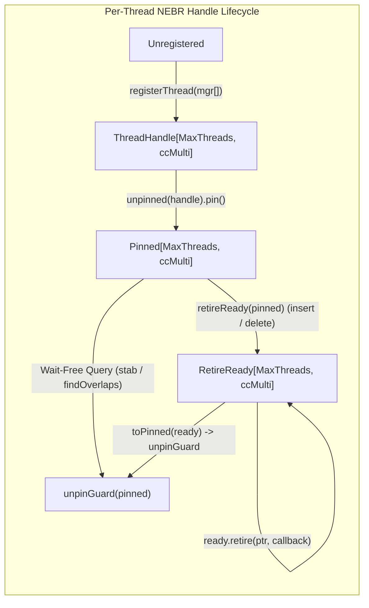

# Concurrency Architecture & Formal Invariants: Concurrent Interval Skip List (`CISL`)

**Document ID**: `DESIGN-LOCKFREE-CISL-001`  
**Author**: `@architect-lynx` (Concurrency & Memory Model Architect)  
**Reviewers**: `@auditor-pegasus` (Adversarial Auditor), `@lockfree-orchestrator` (Lead Orchestrator)  
**Consumer Target**: `@dependanim-orchestrator` (SemVer Package Range Bounds & Parallel CDCL Conflict Clause Matching)  
**Status**: ARCHITECTURAL & SMR SPECIFICATION  
**Target Substrate**: `lockfree` (`src/lockfree/cisl.nim`, `src/lockfree/skiplist.nim`, `src/lockfree/smr/nebr.nim`)  
**Deliverable**: `docs/design/cisl_architecture.md`  

---

## Concurrency Topology & Substrate Banner

```
====================================================================================================
Concurrency Topology: MPMC Lock-Free Concurrent Interval Skip List (IntervalSkipList[K, V])
====================================================================================================
| Dimension              | Architectural Specification                                             |
|:-----------------------|:------------------------------------------------------------------------|
| **Topologies**         | MPMC (Multi-Producer Multi-Consumer Concurrent Interval Index)          |
| **Algorithm**          | Fraser / Herlihy Lock-Free SkipList + Harris Marking + Span-Max Towers  |
| **Interval Ordering**  | Lexicographical Total Order on `(low, high)` at Level 0                 |
| **Augmentation**       | Per-Level Monotonic `spanMaxHigh[L]` Upper-Bound Envelope               |
| **Capacity**           | Dynamically Unbounded (`allocShared0` Node & `VBox[V]` Allocation)      |
| **Coordination**       | 1-Bit LSB Tagged `next[L]` Pointers (`MarkBit = 1'u`) + Atomic CAS      |
| **Payload Storage**    | Type-Agnostic Atomic Pointer-Indirection Box (`VBox[V]`) under ARC/ORC  |
| **Progress Guarantees**| Mutations (`insert`, `delete`): Lock-Free; Queries (`stab`): Wait-Free  |
| **SMR Substrate**      | In-tree Debra / NEBR Epoch SMR (`DebraManager[MaxThreads, ccMulti]`)    |
| **Typestates Gate**    | Lifecycle Typestate (`Init -> Destroyed`) + `Endpoint` Role Enforcement |
| **Primary Consumer**   | `@dependanim-orchestrator` (SemVer Range Solver & Parallel CDCL Clauses)|
====================================================================================================
```

---

## 1. Executive Summary & Problem Formulation

### 1.1 Architectural Gap Analysis
The `lockfree` suite currently provides point-keyed associative containers:
- `SkipListMap[K, V]` ([API docs](../api/skiplist.md)): $O(\log N)$ point lookups and ordered ascending key scans `[k1, k2]` via Fraser/Herlihy lock-free skip lists.
- `Ctrie[K, V]` ([API docs](../api/ctrie.md)): $O(1)$ hash-partitioned point lookups and $O(1)$ generational snapshots.
- `BTable[K, V]`: Fixed-capacity bounded open-addressed concurrent hash table.

However, point-keyed ordered maps cannot efficiently answer **1D interval stabbing** ($\text{find all } [l_i, h_i] \text{ containing point } q$) or **interval overlap** ($\text{find all } [l_i, h_i] \text{ intersecting } [q_{\text{low}}, q_{\text{high}}]$) queries:
1. Ordering a standard `SkipListMap` solely by `low` allows pruning intervals with $l_i > q_{\text{high}}$, but forces an $O(N)$ linear scan of all intervals with $l_i \le q_{\text{high}}$ because an interval starting near $-\infty$ may either end before $q_{\text{low}}$ or span all the way to $+\infty$.
2. Classical augmented interval trees (CLRS red-black or AVL interval trees) require multi-node tree rotations coupled with bottom-up `maxHigh` recalculations. Under fine-grained lock-free CAS execution, tree rotations invalidate ancestor `maxHigh` summaries simultaneously across multiple levels, creating unrecoverable race windows or forcing coarse-grained subtree locks.

### 1.2 The Concurrent Interval Skip List (`CISL`) Solution
`IntervalSkipList[K, V, MaxThreads, MaxLevel]` (aliased as `CISL[K, V]`) augments the rotation-free Fraser/Herlihy lock-free skip list (`src/lockfree/skiplist.nim`) with **level-indexed forward-span upper bounds (`spanMaxHigh[L]`)**:
- Because skip list towers have **fixed height (`topLevel`) chosen at allocation time** and never rotate, level-$L$ express links form a deterministic hierarchical partition over Level-0 intervals.
- By enforcing the **Conservative Over-Approximation Invariant** ($\text{spanMaxHigh}_L(u) \ge \max_{w \in \text{Span}_L(u)} w.\text{high}$) via **Pre-Link Monotonic Propagation** prior to Level-0 publication, wait-free readers can prune entire level-$L$ forward spans in $O(1)$ atomic loads without ever suffering a false negative (missed overlapping interval).

---

## 2. SMR Lifecycle & NEBR Epoch Integration

### 2.1 Integration with `DebraManager[MaxThreads, ccMulti]`
`IntervalSkipList` integrates directly with the in-tree Neutralization-Enhanced Bounded Reclamation (NEBR / Debra) engine in `src/lockfree/smr/nebr.nim` ([API docs](../api/smr/nebr.md)), matching the ownership and lifecycle architecture established in `src/lockfree/skiplist.nim`.



### 2.2 Core Ownership & Reference Counting (`CISLCore`)
`IntervalSkipList` is a lightweight value handle wrapping a heap-allocated, atomically reference-counted `CISLCore`:

```nim
type
  CISLCore*[K, V; MaxThreads: static int, MaxLevel: static int] = object
    id*: uint64
    head*: ptr CISLNode[K, V, MaxLevel]
    tail*: ptr CISLNode[K, V, MaxLevel]
    manager*: ptr DebraManager[MaxThreads, ccMulti]
    count*: Atomic[int]
    rc*: Atomic[int]
    ownsManager*: bool
```

1. **Dedicated vs. Shared SMR Manager**:
   - `newIntervalSkipList[K, V, MaxThreads, MaxLevel]()`: Allocates a cache-line-aligned `DebraManager[MaxThreads, ccMulti]` via `allocAligned[DebraManager[MaxThreads, ccMulti]]()`, initializes it with `initDebraManager[MaxThreads, ccMulti]()`, and sets `ownsManager = true`.
   - `newIntervalSkipList[K, V, MaxThreads, MaxLevel](manager: ptr DebraManager[MaxThreads, ccMulti])`: Binds to a caller-supplied shared `DebraManager` (`manager[].bindClient()`), setting `ownsManager = false`. This allows `@dependanim-orchestrator` to share a single `DebraManager` across multiple `CISL` and `SkipListMap` instances without multiplying thread-slot registrations.
2. **Thread Handle Auto-Registration & Explicit Fast-Path**:
   - Every public operation provides two overloads:
     - **Explicit Handle Overload** (`proc stab*(self, point: K, handle: ThreadHandle[MaxThreads, ccMulti])`): Zero TLS lookup overhead; intended for tight parallel CDCL solver loops holding a bound endpoint or thread handle.
     - **Auto-Registered Overload** (`proc stab*(self, point: K)`): Resolves the calling thread's `ThreadHandle` via a thread-local cache (`gCislTlsHandles {.threadvar.}: seq[TlsHandleEntry]`, capacity 32) indexed by `self.core.id`, falling back to `manager.activeThreadMask` inspection and `registerThread(manager[])` exactly once per thread.
3. **Ephemeral Pin Scope Discipline & Neutralization Recovery**:
   - **Wait-Free Queries (`stab`, `hasOverlap`, `findOverlaps`, `getInterval`)**:
     Acquire `let pinned = unpinned(handle).pin()` on entry and unconditionally execute `unpinGuard(pinned)` in a `finally` block:
     ```nim
     template unpinGuard[MaxThreads: static int, CC: static PinScopeCardinality](
         p: Pinned[MaxThreads, CC]
     ) =
       var res = p.unpin()
       match res:
         Unpinned(u):
           discard u.close()
         Neutralized(n):
           discard n.acknowledge().close()
     ```
     Queries never hold an epoch pin across thread suspension or async `await` points. For streaming callers, `CISL` provides both an ephemeral pinned `iterator overlaps` (synchronous loop bodies) and a materialized `proc findOverlaps` returning `seq[IntervalEntry[K, V]]` before unpinning.
   - **Lock-Free Mutations (`insert`, `upsertInterval`, `deleteInterval`)**:
     Convert `pinned` to `var ready = retireReady(pinned)`. Nodes physically unlinked at Level 0 during `find()` and `VBox[V]` payloads displaced during in-place value CAS are retired to the thread's NEBR limbo bag:
     - `ready.retire(cast[pointer](curr), destroyCISLNodeCallback[K, V, MaxLevel])`
     - `ready.retire(cast[pointer](oldBox), destroyVBoxCallback[V])`
     Mutations invoke `handle.advanceEvery(32)` prior to exiting the `try` block and unpin via `unpinGuard(toPinned(ready))` in `finally`.
4. **Destruction & Teardown Contract (`=destroy`)**:
   - When the last `IntervalSkipList` reference drops (`self.core.rc.fetchSub(1, moRelease) == 1` followed by `threadFence(moAcquire)`), no concurrent accessors remain:
     - Walk Level-0 from `head.next[0]` to `tail`, calling `freeCISLNodeDirect(curr)` on every remaining node.
     - Free `head` and `tail` sentinel nodes.
     - If `ownsManager == true`, invoke `reset(self.core.manager[])` and `freeAligned(self.core.manager)`; otherwise call `self.core.manager[].unbindClient()`.
     - Deallocate `self.core` via `deallocShared(self.core)`.

---

## 3. Interval Node Augmentation & Memory Layout

### 3.1 Boundary Semantics & Total Ordering
An interval $I = [l, h]$ is parameterized over any key type `K` supporting `cmp(a, b)` or `<` (`SomeOrdinal`, `SomeFloat`, `uint64`, or custom `SemVer` tuples) and endpoint inclusivity mask `IntervalBoundKind`:

```nim
type
  IntervalBoundKind* = enum
    ibClosed        = 0'u8  ## [low, high] : low <= x <= high (Default)
    ibHalfOpenRight = 1'u8  ## [low, high) : low <= x <  high
    ibHalfOpenLeft  = 2'u8  ## (low, high] : low <  x <= high
    ibOpen          = 3'u8  ## (low, high) : low <  x <  high

  IntervalKey*[K] = object
    low*: K
    high*: K
    bounds*: IntervalBoundKind
```

#### Canonical Level-0 Total Order (`cmpIntervalKey`)
Nodes in the skip list are ordered at all levels by a strict total order on their interval coordinates:
$$\text{cmpInterval}(A, B) = \begin{cases} \text{keyCmp}(A.\text{low}, B.\text{low}) & \text{if } A.\text{low} \neq B.\text{low} \\ \text{keyCmp}(A.\text{high}, B.\text{high}) & \text{if } A.\text{high} \neq B.\text{high} \\ \text{cmp}(A.\text{bounds}, B.\text{bounds}) & \text{otherwise} \end{cases}$$

- **Head Sentinel (`isHead = true`)**: Compares strictly less than all user intervals ($\text{cmpNodeInterval}(\text{head}, I) = -1$).
- **Tail Sentinel (`isTail = true`)**: Compares strictly greater than all user intervals ($\text{cmpNodeInterval}(\text{tail}, I) = +1$).
- **Precondition**: Every user interval must satisfy $\text{keyCmp}(\text{low}, \text{high}) \le 0$ (and strictly $< 0$ when `bounds != ibClosed`). Attempting to insert an inverted interval ($\text{low} > \text{high}$) raises `ValueError` (or returns `false` on non-raising `tryInsert`).

### 3.2 Augmented Node Layout (`CISLNode`)
To support both lock-free pointer unlinking and wait-free interval pruning without multi-word CAS on tower pointers, each node augments its forward pointer tower `next[MaxLevel]` with a parallel atomic upper-bound tower `spanMaxHigh[MaxLevel]`:

```
+-----------------------------------------------------------------------------------+
|                        CISLNode[K, V, MaxLevel] (Shared Heap)                     |
+-----------------------------------------------------------------------------------+
| low: K                      | Immutable lower endpoint (set before publication)   |
| high: K                     | Immutable upper endpoint (set before publication)   |
| bounds: IntervalBoundKind   | Endpoint inclusivity flags (ibClosed, etc.)         |
| isHead, isTail: bool        | Sentinel flags                                      |
| topLevel: int32             | Tower height in 0 ..< MaxLevel (immutable)          |
| valPtr: Atomic[ptr VBox[V]] | Atomic pointer to payload box (in-place update CAS) |
+-----------------------------------------------------------------------------------+
| next: array[MaxLevel, Atomic[uint]]                                               |
|   Level L entry = (cast[uint](succPtr) or MarkBit)                                |
|   LSB bit 0 (MarkBit = 1'u): Harris logical deletion flag at level L              |
+-----------------------------------------------------------------------------------+
| spanMaxHigh: array[MaxLevel, Atomic[K]]  (or Atomic[ptr KBox[K]] if sizeof(K)>8)  |
|   Level L entry = Conservative upper bound on max(w.high) for all active nodes    |
|                   w in the level-L half-open span [this, toPtr(this.next[L]))     |
| hasSpanBound: array[MaxLevel, Atomic[bool]] (or sentinel K.low)                   |
|   True once spanMaxHigh[L] has been initialized for span [this, next[L])          |
+-----------------------------------------------------------------------------------+
```

> [!IMPORTANT]
> **Atomic Representation of `spanMaxHigh[L]` for Arbitrary `K`**:
> - When `sizeof(K) <= 8` and `K` is trivially copyable (`SomeInteger`, `SomeFloat`, `enum`, packed 64-bit `SemVer` / `uint64`), `spanMaxHigh[L]` is stored directly in-line as `Atomic[K]` using lock-free hardware `compareExchange` (`moAcquireRelease`).
> - When `sizeof(K) > 8` or `K` is a structured tuple/object, `spanMaxHigh[L]` stores `Atomic[ptr KBox[K]]` managed by the same `DebraManager` epoch lifecycle (`ready.retire(oldKBox, destroyKBoxCallback[K])`), avoiding torn reads or spinlocks while preserving wait-free `moAcquire` loads for readers.

### 3.3 The Span-Max Invariant & Why Naïve Tree Augmentation Fails
In a concurrent skip list, suppose node $u$ at level $L > 0$ points to $v = \text{toPtr}(u.\text{next}[L])$. Define the **active level-$L$ span** of $u$ as:
$$\text{ActiveSpan}_L(u) = \{ w \in \text{Level } 0 \mid u \le w < v \land \neg \text{isMarked}(w.\text{next}[0]) \}$$

If a reader at node $u$ on level $L$ is searching for intervals overlapping $[q_{\text{low}}, q_{\text{high}}]$, when is it safe for the reader to advance along the level-$L$ express link from $u$ directly to $v$ without inspecting intermediate nodes at levels $< L$?
1. **Case A (Entire Span Lies Strictly Left of $q_{\text{low}}$)**:
   If every active node $w \in \text{ActiveSpan}_L(u)$ satisfies $w.\text{high} < q_{\text{low}}$, then **no node in $[u, v)$ can possibly overlap $[q_{\text{low}}, q_{\text{high}}]$**. The reader can advance directly from $u$ to $v$ only if it needs to reach nodes $\ge v$; even better, if $u.\text{spanMaxHigh}[L] < q_{\text{low}}$, the reader knows the subpath $[u, v)$ is completely devoid of matches and can skip straight to $v$ at level $L$!
2. **Case B (Span Contains a Potential Match)**:
   If $u.\text{spanMaxHigh}[L] \ge q_{\text{low}}$, at least one node in $[u, v)$ *might* have $w.\text{high} \ge q_{\text{low}}$, so the reader drops down to level $L - 1$ at $u$ to inspect the finer-grained sub-spans.

#### The Concurrency Hazard (False Negative via Late Augmentation)
Suppose Thread A inserts a new interval $x = [10, 500]$ at Level 0 between $u = [5, 10]$ and $v = [20, 25]$, where $u \to_L v$ is an express link at level $L = 3$ with $u.\text{spanMaxHigh}[3] = 10$.
- **Broken Order (Post-Link Augmentation)**: If Thread A links $x$ into Level 0 *first* and updates $u.\text{spanMaxHigh}[3] \leftarrow 500$ *afterward*, then a concurrent Thread B executing `stab(250)` between those two steps will see $u.\text{spanMaxHigh}[3] = 10 < 250$, skip over $[u, v)$ at level 3, and **miss $x = [10, 500]$ even though $x$ was already linearized at Level 0!**
- **Sound Order (Pre-Link Monotonic Raise)**: Thread A MUST raise $u_L.\text{spanMaxHigh}[L] \leftarrow \max(u_L.\text{spanMaxHigh}[L], x.\text{high})$ for all predecessors $u_0, u_1, \dots, u_{\text{MaxLevel}-1}$ found during `find()` **BEFORE** executing the Level-0 insertion CAS (`pred0.next[0].compareExchange`)!

```
Timeline of Pre-Link Monotonic Raise (Zero False Negatives):
--------------------------------------------------------------------------------
Step 1: find(x) records preds[0..MaxLevel-1] and succs[0..MaxLevel-1]
Step 2: For L in 0 ..< MaxLevel:
          atomicMax(preds[L].spanMaxHigh[L], x.high, moAcquireRelease)
Step 3: Initialize x.spanMaxHigh[0..topLevel] = x.high
Step 4: CAS pred0.next[0]: succ0 -> x   <=== LINEARIZATION POINT OF INSERT(x)
Step 5: Link x at levels L = 1 .. topLevel and refresh split-span bounds
--------------------------------------------------------------------------------
```

Because `preds[L].spanMaxHigh[L]` is guaranteed to be $\ge x.\text{high}$ *before* Step 4 linearizes $x$ at Level 0 (and if `preds[L]` changes before Step 4, either the new predecessor already covers $x$ or `pred0.next[0]` CAS / re-verification catches it), **Conservative Over-Approximation holds at every instant**:

$$\text{Invariant (I-SPAN):} \quad \forall u \in \text{CISL}, \forall L \in [0, u.\text{topLevel}]: \quad u.\text{spanMaxHigh}[L] \ge \max_{w \in \text{ActiveSpan}_L(u)} w.\text{high}$$

---

## 4. Concurrency Invariants & CAS Protocols

### 4.1 Atomic Helper: Monotonic `atomicRaiseMax`
To update `spanMaxHigh[L]` without lost updates under concurrent insertions:

```nim
proc atomicRaiseMax*[K](target: var Atomic[K], candidate: K) {.inline, notATransition.} =
  var cur = target.load(moAcquire)
  while keyCmp(cur, candidate) < 0:
    if target.compareExchange(cur, candidate, moAcquireRelease, moAcquire):
      break
```

- **Wait-Free Bounded Termination on Distinct Updates**: Because `cur` strictly increases on every failed CAS retry, `atomicRaiseMax` is lock-free and monotonically non-decreasing during an epoch between compactions.

### 4.2 Lock-Free Insertion Protocol (`insert` / `upsertInterval`)

```mermaid
sequenceDiagram
    participant W as Writer Thread
    participant Preds as preds[0..MaxLevel-1]
    participant Node as New CISLNode x
    participant SMR as DebraManager (NEBR)

    W->>SMR: pinned = unpinned(handle).pin(); ready = retireReady(pinned)
    W->>Preds: find(x.key, preds, succs, ready)
    alt Exact (low, high, bounds) Exists at succs[0]
        W->>Preds: CAS succs[0].valPtr (oldBox -> newBox, moAcqRel)
        W->>SMR: ready.retire(oldBox, destroyVBoxCallback)
    else New Interval Node x
        W->>Node: Allocate CISLNode(low, high, topLevel), init spanMaxHigh[0..topLevel] = x.high
        W->>Preds: Pre-Link Raise: for L in 0..<MaxLevel: atomicRaiseMax(preds[L].spanMaxHigh[L], x.high)
        W->>Preds: Verify preds[L].next[L] unchanged (else retry find)
        W->>Preds: Linearize Level-0: CAS preds[0].next[0] (succs[0] -> x, moAcqRel)
        loop For L in 1 .. x.topLevel
            W->>Node: Compute x.spanMaxHigh[L] over [x, succs[L])
            W->>Preds: CAS preds[L].next[L] (succs[L] -> x, moAcqRel)
            W->>Preds: Ensure atomicRaiseMax(preds[L].spanMaxHigh[L], x.high)
        end
    end
    W->>SMR: handle.advanceEvery(32); unpinGuard(toPinned(ready))
```

#### Step-by-Step Insertion Protocol & Edge-Case Verification
1. **Search & Physical Cleanup (`find`)**:
   - Traverse from `level = MaxLevel - 1` down to `0` exactly as in `src/lockfree/skiplist.nim` (Fraser/Herlihy physical unlinking), sniping logically marked nodes via `pred.next[level].compareExchange(toEntry(curr, false), toEntry(succ, false), moAcquireRelease, moAcquire)` and retiring unlinked Level-0 nodes via `ready.retire`.
   - Record `preds[0 .. MaxLevel - 1]` and `succs[0 .. MaxLevel - 1]`.
2. **Duplicate Interval Coordinate Check**:
   - If `succs[0]` has identical `(low, high, bounds)` and is unmarked:
     - Construct `newBox = newVBox(val)`.
     - Attempt `succs[0].valPtr.compareExchange(oldBox, newBox, moAcquireRelease, moAcquire)`.
     - On success, `ready.retire(cast[pointer](oldBox), destroyVBoxCallback[V])` and return `false` (updated existing interval).
     - On failure (or if `succs[0].next[0]` became marked), immediately free `newBox` via `freeVBox(newBox)` (Guaranteed Discard Protocol) and retry.
3. **Node Allocation & Local Initialization**:
   - Allocate `newNode` with `topLevel = randomLevel(MaxLevel)`.
   - Set `newNode.low = low`, `newNode.high = high`, `newNode.bounds = bounds`, `newNode.valPtr = newVBox(val)`.
   - For `level in 0 .. topLevel`:
     - `newNode.next[level].store(toEntry(succs[level], false), moRelaxed)`
     - `newNode.spanMaxHigh[level].store(high, moRelaxed)`
4. **Pre-Link Monotonic Bound Propagation & Snapshot Validation**:
   - For every `level in 0 ..< MaxLevel`:
     - Call `atomicRaiseMax(preds[level].spanMaxHigh[level], high)`.
   - **Predecessor Stability Validation**:
     - After raising `preds[level].spanMaxHigh[level]`, verify that `preds[level].next[level].load(moAcquire) == toEntry(succs[level], false)` for `level in 0 ..< MaxLevel`.
     - Why? If a concurrent thread inserted a new node $p'$ at level $L$ between `preds[L]` and `succs[L]` *before* our raise, $p'$ is now the true level-$L$ predecessor of `newNode` and must also have its `spanMaxHigh[L]` raised to $\ge \text{high}$ before `newNode` is published at Level 0. If any `preds[L].next[L]` changed, re-run `find` (no memory leak; `newNode` can be reused across retries).
5. **Level-0 Publication (The Linearization Point)**:
   - Execute `preds[0].next[0].compareExchange(toEntry(succs[0], false), toEntry(newNode, false), moAcquireRelease, moAcquire)`.
   - If this CAS fails, free `newNode` (or loop back to Step 1 reusing `newNode`).
   - Once this CAS succeeds, `newNode` is linearized in the CISL, and every ancestor span containing `newNode` already has `spanMaxHigh[L] >= newNode.high`!
6. **Upper-Level Tower Linking (`level in 1 .. topLevel`)**:
   - For each `level` from `1` up to `topLevel`:
     - If `isMarked(newNode.next[0].load(moAcquire))` (concurrently deleted before tower completion), abort tower building immediately.
     - Compute the initial span upper bound for `newNode` at `level`:
       - Walk level `level - 1` from `newNode` to `succs[level]` (bounded by an expected 2 hops!) taking the maximum of `w.spanMaxHigh[level - 1]` and `preds[level].spanMaxHigh[level]`, and call `atomicRaiseMax(newNode.spanMaxHigh[level], spanBound)`.
     - Link `newNode` at `level` via `preds[level].next[level].compareExchange(toEntry(succs[level], false), toEntry(newNode, false), moAcquireRelease, moAcquire)`.
     - If the CAS fails, refresh `preds` and `succs` via `find()`, call `atomicRaiseMax(preds[level].spanMaxHigh[level], high)` on the refreshed predecessor, update `newNode.next[level]`, and retry.

### 4.3 Lock-Free Deletion Protocol (`deleteInterval`)

Deletion follows the two-phase Harris-Fraser logical marking and physical splicing protocol:

1. **Locate Target Node**:
   - Call `find(targetKey, preds, succs, ready)`. If not found, return `false`.
   - Let `victim = succs[0]`.
2. **Phase 1 — Top-Down Upper Tower Logical Marking (`level = victim.topLevel` down to `1`)**:
   - For each `level` in `countdown(victim.topLevel, 1)`:
     - Atomically set `MarkBit` on `victim.next[level]` via `compareExchange` (`moAcquireRelease`).
     - Marking upper levels first ensures no new express-lane traversals route through `victim` while preserving `victim.next[level]`'s target pointer (`toPtr(victim.next[level])`) for any concurrent reader currently mid-hop on `victim`.
3. **Phase 2 — Level-0 Logical Marking (The Linearization Point)**:
   - Atomically set `MarkBit` on `victim.next[0]` via `victim.next[0].compareExchange(succEntry0, toEntry(succPtr0, true), moAcquireRelease, moAcquire)`.
   - If `victim.next[0]` was already marked by a racing deleter, return `false` (only the single thread that flips `MarkBit` on `next[0]` decrements `self.core.count` and returns `true`).
4. **Phase 3 — Physical Splicing, SMR Retirement, and Lazy Bound Tightening**:
   - Invoke `discard self.find(targetKey, preds, succs, ready)` to physically snip `victim` across all levels `MaxLevel - 1` down to `0`.
   - When `find` snips `victim` at `level == 0`, it invokes `ready.retire(cast[pointer](victim), destroyCISLNodeCallback[K, V, MaxLevel])`.
   - **Why `spanMaxHigh` Remains Sound Without Blocking on Delete**:
     - Because `spanMaxHigh[L]` is a *conservative upper bound* ($\ge$ true max of active nodes in span), removing `victim` only *decreases* the true maximum of $\text{ActiveSpan}_L(u)$. Leaving `u.spanMaxHigh[L]` at its previous higher value is 100% sound (zero false negatives; at worst, one extra level drop before pruning).
     - **Amortized Bound Tightening**: Whenever `find` physically unlinks a marked node at `level > 0` (swinging `pred.next[level]` from `curr` to `succ`), `pred` absorbs `curr`'s forward span (`atomicRaiseMax(pred.spanMaxHigh[level], curr.spanMaxHigh[level].load(moAcquire))`). Periodically (e.g., when a level-0 physical unlink retires a node whose `high == pred.spanMaxHigh[1]`), a non-blocking single-span recomputation over the expected 2 children at `level - 1` tightens `pred.spanMaxHigh[level]` if no concurrent writer raced.

### 4.4 Wait-Free Population Queries (`stab`, `hasOverlap`, `findOverlaps`)

#### Overlap Predicate (`intervalsOverlap`)
Two intervals $A = (l_A, h_A, b_A)$ and $B = (l_B, h_B, b_B)$ overlap if and only if $A$ does not lie strictly to the left of $B$ and $B$ does not lie strictly to the right of $A$:
- For closed intervals (`ibClosed`, $[l_A, h_A]$ and $[l_B, h_B]$):
  $$\text{overlaps}(A, B) \iff (l_A \le h_B) \land (h_A \ge l_B)$$
- A point-stabbing query `stab(q)` is the special case $B = [q, q]$ (`ibClosed`):
  $$\text{containsPoint}(A, q) \iff (l_A \le q) \land (h_A \ge q)$$

#### Multi-Level Pruning Traversal (`findOverlaps` / `stab`)
Wait-free readers execute **zero CAS instructions**, never help unlink marked nodes, and never allocate SMR retirement bags:

```
Level 3: [HEAD] =================== (spanMaxHigh=45 < qLow=50: SKIP SPAN!) ===================> [u3: [40, 90]] ---> [TAIL]
                                                                                                      | (spanMaxHigh=90 >= 50: DROP)
Level 2: [HEAD] ---> [u1: [10, 20]] ---> [u2: [25, 45]] --------------------------------------> [u3: [40, 90]] ---> [TAIL]
                                                                                                      |
Level 0: [HEAD] -> [10,20] -> [15,30] -> [25,45] -> [35,42] -> [40,90] -> [55,70] -> [85,99] -> [TAIL]
                                                                ^^^^^^^    ^^^^^^^    ^^^^^^^
                                                                Match 1    Match 2    Stop at low=85 > qHigh=80!
```

```nim
proc findOverlaps*[K, V; MaxThreads, MaxLevel: static int](
    self: IntervalSkipList[K, V, MaxThreads, MaxLevel],
    qLow, qHigh: K,
    handle: ThreadHandle[MaxThreads, ccMulti],
    qBounds: IntervalBoundKind = ibClosed
): seq[IntervalEntry[K, V]] {.notATransition.} =
  ## Wait-free population overlap query returning all active intervals intersecting [qLow, qHigh].
  if unlikely(self.core == nil): return @[]
  let pinned = unpinned(handle).pin()
  try:
    result = @[]
    # Phase 1: Top-down express-lane pruning to find the leftmost candidate node at Level 0
    # whose span can reach >= qLow.
    var pred = self.core.head
    for level in countdown(MaxLevel - 1, 1):
      var currEntry = pred.next[level].load(moAcquire)
      var curr = toPtr[CISLNode[K, V, MaxLevel]](currEntry)
      while curr != nil and not curr.isTail:
        # Early right-boundary check: if curr.low > qHigh, no node >= curr can overlap.
        if keyCmp(curr.low, qHigh) > 0:
          break
        # Check if the ENTIRE level-span [pred, curr) has spanMaxHigh < qLow:
        let spanMax = pred.spanMaxHigh[level].load(moAcquire)
        if keyCmp(spanMax, qLow) < 0:
          # Safe to skip directly across [pred, curr) at this express level!
          pred = curr
          currEntry = pred.next[level].load(moAcquire)
          curr = toPtr[CISLNode[K, V, MaxLevel]](currEntry)
        else:
          # At least one node in [pred, curr) has high >= qLow; drop down a level at pred.
          break

    # Phase 2: Level-0 scan from `pred` with express-lane leapfrogging over low-high deserts
    var curr = toPtr[CISLNode[K, V, MaxLevel]](pred.next[0].load(moAcquire))
    while curr != nil and not curr.isTail:
      # Strict Right-Boundary Early Exit:
      # Because Level 0 is sorted by `low`, once `curr.low > qHigh`, NO subsequent node can overlap!
      if keyCmp(curr.low, qHigh) > 0:
        break

      let succEntry0 = curr.next[0].load(moAcquire)
      if not isMarked(succEntry0):
        if intervalsOverlap(curr.low, curr.high, curr.bounds, qLow, qHigh, qBounds):
          let box = curr.valPtr.load(moAcquire)
          if box != nil:
            result.add(IntervalEntry[K, V](
              low: curr.low,
              high: curr.high,
              bounds: curr.bounds,
              val: box.val
            ))

      # Optional Express Leapfrog: If curr has a tower level L >= 1 whose spanMaxHigh[L] < qLow,
      # jump directly to toPtr(curr.next[L]) instead of stepping one node at Level 0!
      var jumped = false
      for level in countdown(curr.topLevel, 1):
        let spanMax = curr.spanMaxHigh[level].load(moAcquire)
        if keyCmp(spanMax, qLow) < 0:
          let nextL = toPtr[CISLNode[K, V, MaxLevel]](curr.next[level].load(moAcquire))
          if nextL != nil:
            curr = nextL
            jumped = true
            break
      if not jumped:
        curr = toPtr[CISLNode[K, V, MaxLevel]](succEntry0)
  finally:
    unpinGuard(pinned)
```

#### Complexity & Wait-Free Progress Proof
1. **Wait-Free Bound**:
   - In Phase 1, at each level $L \in [1, \text{MaxLevel}-1]$, `pred` only advances rightward (`curr.low` strictly non-decreasing, finite number of nodes) and never loops backward or retries on CAS failure.
   - In Phase 2, every iteration advances `curr` strictly forward along a DAG of `next` pointers (even if `curr` is concurrently marked by a deleter, `toPtr(curr.next[0])` still points forward toward `tail`) and halts immediately once `curr.low > qHigh` or `curr == tail`.
   - Therefore, `stab`, `hasOverlap`, and `findOverlaps` are **wait-free for bounded population** (zero retry loops, zero CAS instructions, zero lock acquisitions).
2. **Asymptotic Time Complexity**:
   - Phase 1 locates the first overlapping region in $O(\log N)$ expected hops.
   - Phase 2 visits overlapping intervals plus skips any intermediate non-overlapping clusters ("deserts" where $l_i < q_{\text{low}}$ and $h_i < q_{\text{low}}$) via the **Express Leapfrog** loop (`for level in countdown(curr.topLevel, 1)`), yielding $O(\log N + k)$ expected query time for $k$ reported intervals.

---

## 5. Memory Ordering & Linearization Specification

### 5.1 Formal Memory Ordering Table

| Operation | Atomic Target | Memory Order | Formal Justification |
|:---|:---|:---|:---|
| Pre-Link Span Raise | `preds[L].spanMaxHigh[L]` | `moAcquireRelease` | Establishes happens-before prior to Level-0 publication so no reader observes the new node without observing `spanMaxHigh[L] >= high`. |
| Level-0 Insert CAS | `preds[0].next[0]` | `moAcquireRelease` / `moAcquire` | **Linearization point of `insert`**: publishes `newNode`'s `low`, `high`, `bounds`, and `valPtr` to all acquiring readers. |
| Upper Tower Link CAS | `preds[L].next[L]` ($L \ge 1$) | `moAcquireRelease` / `moAcquire` | Publishes express link after `newNode.spanMaxHigh[L]` has been initialized with `moRelease`. |
| Value Update CAS | `node.valPtr` | `moAcquireRelease` / `moAcquire` | **Linearization point of in-place update**: atomically swaps `ptr VBox[V]` before retiring displaced box to NEBR. |
| Logical Mark CAS | `victim.next[L]` | `moAcquireRelease` / `moAcquire` | At $L = 0$, **linearization point of `deleteInterval`**: sets `MarkBit` so subsequent readers ignore `victim`. |
| Physical Unlink CAS | `pred.next[L]` | `moAcquireRelease` / `moAcquire` | Splices out logically marked node `curr` before `ready.retire(curr, destroyCISLNodeCallback)` at $L = 0$. |
| Query Pointer Load | `node.next[L]` | `moAcquire` | Synchronizes with `moAcquireRelease` insertion/unlinking CAS; observes initialized node fields. |
| Query Span-Max Load | `node.spanMaxHigh[L]` | `moAcquire` | Synchronizes with `atomicRaiseMax` (`moAcquireRelease`); guarantees conservative upper bound visibility. |

### 5.2 Linearization Points Summary
1. **`insert(low, high, val)` (New Interval)**: Linearizes at the successful `preds[0].next[0].compareExchange` linking `newNode` at Level 0.
2. **`insert(low, high, val)` / `upsertInterval` (Existing Interval)**: Linearizes at the successful `existingNode.valPtr.compareExchange(oldBox, newBox, moAcquireRelease, moAcquire)`.
3. **`deleteInterval(low, high)`**: Linearizes at the successful `victim.next[0].compareExchange` that transitions `MarkBit` from `0` to `1` at Level 0.
4. **`stab(point)` / `findOverlaps(qLow, qHigh)`**:
   - Single-match `findFirstOverlap` / `hasOverlap`: Linearizes at the `moAcquire` load of `curr.next[0]` (proving unmarked status) and `curr.valPtr` for a matching interval, or at the terminal `moAcquire` load reaching `curr.low > qHigh` / `tail`.
   - Multi-match `findOverlaps` / `stab`: Weakly consistent linearizable range scan (guaranteed to return every interval that remained continuously present throughout the scan, never returning torn payloads or uninitialized memory).

---

## 6. Typestate Verification & Dual-API Surface

To comply with `lockfree`'s universal compile-time typestate architecture (`src/lockfree/endpoint.nim`, `src/lockfree/typestates/with_bound.nim`):

### 6.1 Lifecycle Typestate Machine
```nim
typestate IntervalSkipList[K, V, MaxThreads, MaxLevel]:
  states:
    Init
    Destroyed
  transitions:
    Init -> Destroyed
```
- `newIntervalSkipList` / `initIntervalSkipList` construct `IntervalSkipList` in the `Init` state (`{. constructor .}`).
- `close(self: sink IntervalSkipList)` transitions `Init -> Destroyed` (`{. transition: "Init -> Destroyed" .}`).
- All query and mutation procs (`insert`, `deleteInterval`, `stab`, `findOverlaps`, `hasOverlap`, `len`) are annotated with `{.notATransition.}` so `typestates verify -W --format=github src/` passes with zero warnings.

### 6.2 Role-Restricted Endpoints (`TableWriterTag` / `TableReaderTag`)
`IntervalSkipList` integrates with `Endpoint` and `withBoundWriter` / `withBoundReader`:
- **`Bound[T, TableWriterTag, CISLType]`**: Permits `insert`, `upsertInterval`, `deleteInterval`, `stab`, `findOverlaps`, and `hasOverlap`.
- **`Bound[T, TableReaderTag, CISLType]`**: Permits wait-free `stab`, `findOverlaps`, and `hasOverlap`; attempting to call `insert` or `deleteInterval` on a `TableReaderTag` endpoint triggers a compile-time `{.error: "TableReader endpoint cannot mutate IntervalSkipList", notATransition.}` guard.
- **Automatic NEBR Scope Binding**: `onBind` registers the thread's `ThreadHandle[MaxThreads, ccMulti]` with `cisl.core.manager[]`, and `onClose` drains the thread's limbo bags (`reclaimNow(handle)`) before calling `unregisterThread(cisl.core.manager[], handle)`.

---

## 7. Consumer Target Integration: `@dependanim-orchestrator`

`@dependanim-orchestrator` requires a high-throughput, lock-free interval index for two core subsystems in `dependanim`:

### 7.1 Subsystem A: SemVer Package Range Bounds Resolution
In `dependanim`, package version constraints (e.g., `>= 1.2.0 & < 2.0.0`, `^0.4.2`, `~2.1.0`) normalize into closed or half-open intervals over a packed 64-bit `SemVerKey`:
```nim
type
  SemVerKey* = uint64
  ## Bit layout: [major: 20 bits][minor: 20 bits][patch: 20 bits][prereleaseRank: 4 bits]

  VersionConstraintClause* = object
    pkgId*: uint32
    depRequirementId*: uint32
    incompatibilityMask*: uint64
```
- **Concurrent Dependency Discovery**: Multiple resolver worker threads parse Nimble/lockfile manifests in parallel and insert version constraint intervals into `CISL[SemVerKey, VersionConstraintClause]` via `cisl.insert(minVer, maxVer, clause, handle, bounds = ibHalfOpenRight)`.
- **Wait-Free Candidate Stabbing (`stab`)**: When evaluating a candidate package release `v`, the solver executes `cisl.stab(v, handle)` in $O(\log N + k)$ wait-free time to retrieve all active dependency requirements and incompatibility clauses covering `v`.
- **Range Intersection (`findOverlaps`)**: When narrowing a package's admissible version window `[lowVer, highVer]`, `cisl.findOverlaps(lowVer, highVer, handle)` prunes non-overlapping version epochs at high skip-list levels via `spanMaxHigh[L]`.

### 7.2 Subsystem B: Parallel CDCL Conflict Clause Matching
In `dependanim`'s parallel Conflict-Driven Clause Learning (CDCL) SAT/version solver:
- Multiple solver threads explore search branches concurrently across distinct decision levels and trail intervals.
- **Conflict Clause Interval Indexing**:
  - Every learned conflict clause $C$ spans a decision-level or assignment-timestamp interval $[\text{dl}_{\min}(C), \text{dl}_{\max}(C)]$ (or literal variable ID range $[v_{\min}(C), v_{\max}(C)]$).
  - When a worker derives a conflict at decision level $\text{dl}$, it immediately publishes the learned nogood into the shared `CISL[uint32, LearnedClause]`:
    ```nim
    discard learnedIndex.insert(clause.minDecisionLevel, clause.maxDecisionLevel, clause, workerHandle)
    ```
- **Wait-Free Backjump & Unit Propagation Queries**:
  - When a peer worker backjumps to decision level $\text{dl}_{\text{target}}$ or propagates assignments across $[\text{dl}_1, \text{dl}_2]$, it calls:
    ```nim
    for entry in learnedIndex.overlaps(dlTarget, currentDl, workerHandle):
      applyLearnedClause(solverState, entry.val)
    ```
  - Because `overlaps` / `stab` is wait-free and protected by NEBR epochs (`DebraManager`), reader workers never contend on cache-line spinlocks with clause-learning writers, and obsolete/subsumed learned clauses deleted via `learnedIndex.deleteInterval(low, high, workerHandle)` are safely reclaimed in the background once all active propagation scopes unpin.

---

## 8. Public API Specification (`src/lockfree/cisl.nim`)

```nim
type
  IntervalBoundKind* = enum
    ibClosed        = 0'u8  ## [low, high]
    ibHalfOpenRight = 1'u8  ## [low, high)
    ibHalfOpenLeft  = 2'u8  ## (low, high]
    ibOpen          = 3'u8  ## (low, high)

  IntervalEntry*[K, V] = object
    low*: K
    high*: K
    bounds*: IntervalBoundKind
    val*: V

  IntervalSkipList*[
    K, V;
    MaxThreads: static int = DefaultMaxThreads,
    MaxLevel: static int = DefaultMaxLevel
  ] = object
    core*: ptr CISLCore[K, V, MaxThreads, MaxLevel]

  CISL*[
    K, V;
    MaxThreads: static int = DefaultMaxThreads,
    MaxLevel: static int = DefaultMaxLevel
  ] = IntervalSkipList[K, V, MaxThreads, MaxLevel]

# Constructors & Lifecycle
proc newIntervalSkipList*[K, V; MaxThreads: static int = 64, MaxLevel: static int = 16](): IntervalSkipList[K, V, MaxThreads, MaxLevel]
proc newIntervalSkipList*[K, V; MaxThreads: static int = 64, MaxLevel: static int = 16](
  manager: ptr DebraManager[MaxThreads, ccMulti]
): IntervalSkipList[K, V, MaxThreads, MaxLevel]
proc initIntervalSkipList*[K, V; MaxThreads: static int = 64, MaxLevel: static int = 16](): IntervalSkipList[K, V, MaxThreads, MaxLevel]

# Thread Registration
proc registerThread*[K, V; MaxThreads, MaxLevel: static int](
  self: var IntervalSkipList[K, V, MaxThreads, MaxLevel]
): ThreadHandle[MaxThreads, ccMulti] {.notATransition.}
proc unregisterThread*[K, V; MaxThreads, MaxLevel: static int](
  self: var IntervalSkipList[K, V, MaxThreads, MaxLevel],
  handle: ThreadHandle[MaxThreads, ccMulti]
) {.notATransition.}

# Lock-Free Mutations
proc insert*[K, V; MaxThreads, MaxLevel: static int](
  self: var IntervalSkipList[K, V, MaxThreads, MaxLevel],
  low, high: K,
  val: V,
  handle: ThreadHandle[MaxThreads, ccMulti],
  bounds: IntervalBoundKind = ibClosed
): bool {.notATransition.}

proc insert*[K, V; MaxThreads, MaxLevel: static int](
  self: var IntervalSkipList[K, V, MaxThreads, MaxLevel],
  low, high: K,
  val: V,
  bounds: IntervalBoundKind = ibClosed
): bool {.inline, notATransition.}

proc upsertInterval*[K, V; MaxThreads, MaxLevel: static int](
  self: var IntervalSkipList[K, V, MaxThreads, MaxLevel],
  low, high: K,
  insertVal: V,
  updateProc: proc(oldVal: V): V {.closure, gcsafe.},
  handle: ThreadHandle[MaxThreads, ccMulti],
  bounds: IntervalBoundKind = ibClosed
): V {.notATransition.}

proc deleteInterval*[K, V; MaxThreads, MaxLevel: static int](
  self: var IntervalSkipList[K, V, MaxThreads, MaxLevel],
  low, high: K,
  handle: ThreadHandle[MaxThreads, ccMulti],
  bounds: IntervalBoundKind = ibClosed
): bool {.notATransition.}

proc deleteInterval*[K, V; MaxThreads, MaxLevel: static int](
  self: var IntervalSkipList[K, V, MaxThreads, MaxLevel],
  low, high: K,
  bounds: IntervalBoundKind = ibClosed
): bool {.inline, notATransition.}

# Wait-Free Point-Stabbing & Interval-Overlap Queries
proc stab*[K, V; MaxThreads, MaxLevel: static int](
  self: IntervalSkipList[K, V, MaxThreads, MaxLevel],
  point: K,
  handle: ThreadHandle[MaxThreads, ccMulti]
): seq[IntervalEntry[K, V]] {.notATransition.}

proc stab*[K, V; MaxThreads, MaxLevel: static int](
  self: IntervalSkipList[K, V, MaxThreads, MaxLevel],
  point: K
): seq[IntervalEntry[K, V]] {.inline, notATransition.}

proc hasPointOverlap*[K, V; MaxThreads, MaxLevel: static int](
  self: IntervalSkipList[K, V, MaxThreads, MaxLevel],
  point: K,
  handle: ThreadHandle[MaxThreads, ccMulti]
): bool {.notATransition.}

proc findOverlaps*[K, V; MaxThreads, MaxLevel: static int](
  self: IntervalSkipList[K, V, MaxThreads, MaxLevel],
  qLow, qHigh: K,
  handle: ThreadHandle[MaxThreads, ccMulti],
  qBounds: IntervalBoundKind = ibClosed
): seq[IntervalEntry[K, V]] {.notATransition.}

proc findOverlaps*[K, V; MaxThreads, MaxLevel: static int](
  self: IntervalSkipList[K, V, MaxThreads, MaxLevel],
  qLow, qHigh: K,
  qBounds: IntervalBoundKind = ibClosed
): seq[IntervalEntry[K, V]] {.inline, notATransition.}

proc hasOverlap*[K, V; MaxThreads, MaxLevel: static int](
  self: IntervalSkipList[K, V, MaxThreads, MaxLevel],
  qLow, qHigh: K,
  handle: ThreadHandle[MaxThreads, ccMulti],
  qBounds: IntervalBoundKind = ibClosed
): bool {.notATransition.}

iterator overlaps*[K, V; MaxThreads, MaxLevel: static int](
  self: IntervalSkipList[K, V, MaxThreads, MaxLevel],
  qLow, qHigh: K,
  handle: ThreadHandle[MaxThreads, ccMulti],
  qBounds: IntervalBoundKind = ibClosed
): IntervalEntry[K, V]
```

---

## 9. Verification & Adversarial Audit Criteria (Three-Key Gate)

To pass the Three-Key Gate during implementation (`tests/t_cisl.nim` and `tests/should_fail/`):
1. **Zero False-Negative Overlap Invariant Test**:
   - Spawn 8 writer threads continuously inserting and deleting wide intervals $[l_i, h_i]$ interleaved with narrow intervals while 8 reader threads execute `stab(q)` and `findOverlaps(qLow, qHigh)`.
   - Maintain a set of "pinned ground-truth intervals" never deleted during the run; assert that **100% of ground-truth intervals overlapping `[qLow, qHigh]` are returned on every single `findOverlaps` and `stab` call** (zero false negatives under concurrent tower linking and physical unlinking).
2. **High-Level Pruning Efficiency Verification**:
   - Populate $100,000$ disjoint short intervals $[10i, 10i + 5]$ for $i \in [0, 100000)$.
   - Execute `findOverlaps(950_000, 950_050)` and `stab(500_003)` and verify via node-visit instrumentation that the traversal visits $O(\log N)$ nodes rather than scanning $O(N)$ Level-0 nodes.
3. **NEBR Epoch Reclamation & ARC/ORC Leak Verification**:
   - Execute $200,000$ concurrent `insert` / `upsertInterval` / `deleteInterval` cycles with heap-backed `string` and `seq[uint32]` payloads (simulating CDCL learned clauses) under `--mm:orc`, verifying zero memory leaks and clean `unregisterThread` limbo drainage.
4. **Compile-Time Typestate & Negative Control Verification**:
   - Verify `typestates verify -W --format=github src/` passes with 0 errors/warnings.
   - Add negative control in `tests/should_fail/` proving a `TableReaderTag` bound endpoint to `IntervalSkipList` cannot invoke `insert` or `deleteInterval`.
